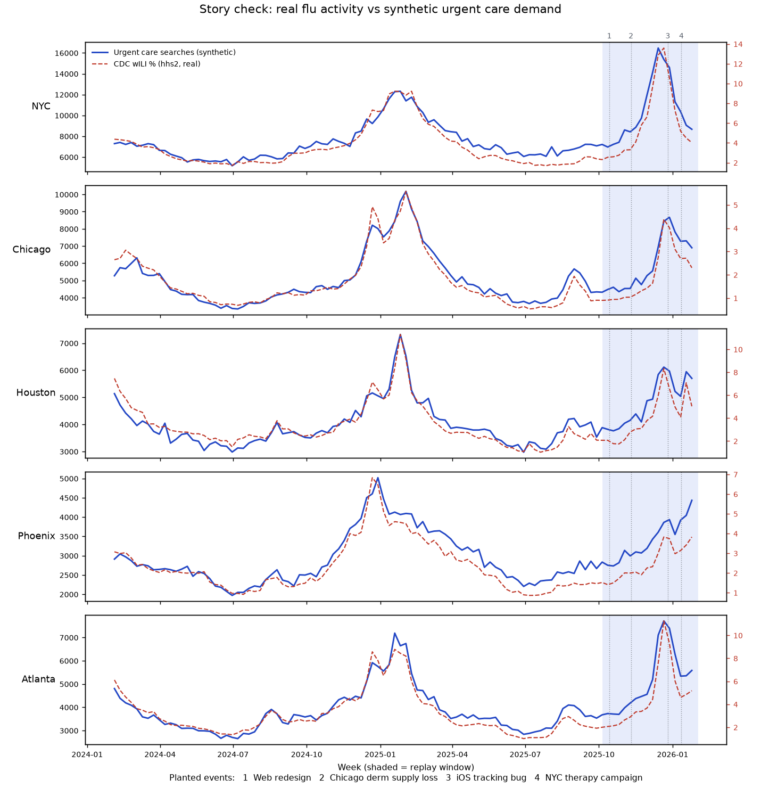

# Data Agent Orchestration

A multi-agent analyst that does the job of a weekly business review: when a marketplace KPI moves, it works out why.

> Status: in progress. This README is a placeholder until the first replay runs are done.

## What it does

Each run replays one past week of a two-sided healthcare booking marketplace (patients searching and booking, providers offering appointment slots). A SQL detector flags unusual metric movements. A LangGraph team of agents then decomposes each movement through the KPI tree, checks supply, funnel, data quality and outside factors, and writes a WBR-style memo. A skeptic agent rejects any claim that isn't backed by the data before the memo is written.

## Data

- **Outside world (real):** regional flu activity from CDC ILINet.
- **Inside the company (synthetic):** daily searches, funnel steps, bookings and provider supply for 5 markets × 6 specialties × 3 platforms over 2 years.
- **Planted scenarios:** supply loss, a tracking bug, a product change, a marketing campaign, plus decoys and normal seasonality. Each has a known answer, so every run can be scored automatically. The evaluation design follows InsightBench's planted-insight method.

Table and column definitions: [`data/DATA_DICTIONARY.md`](data/DATA_DICTIONARY.md).



Synthetic urgent care demand follows each market's real flu curve (weekly correlation 0.90 to 0.95). The 2025–26 season peaked about six weeks earlier than the one before: more severe in NYC and Atlanta, milder in Chicago, Houston and Phoenix.

### Rebuild the data

```bash
conda create -n dao python=3.12 && conda activate dao
pip install -r requirements.txt
python data_gen/fetch_flu.py   # download CDC flu data (snapshot already in data/)
python data_gen/generate.py    # write the synthetic tables to data/
python data_gen/checks.py      # verify the data tells the intended story; redraw the chart
```

The generator is deterministic (fixed seed). Every planted effect is measured against a counterfactual world with identical noise and only that effect removed, so the answer key records each effect's true size (`evals/effect_sizes.csv`).

## Stack

LangGraph · Claude API (Haiku for routing, Sonnet for judgment) · TruLens · Snowflake · Python

## Repo layout

| Folder | Contents |
|---|---|
| `config/` | World assumptions: seasonality, flu sensitivity, market sizes |
| `data_gen/` | Synthetic data generator and CDC download |
| `data/` | Generated tables and the CDC snapshot |
| `sql/` | Detector queries |
| `agents/` | One module per graph node |
| `skills/` | Instructions each agent reads |
| `evals/` | Answer key (`scenarios.yaml`) and scoring |
| `runs/` | Memos and exported traces from each replay |
| `docs/` | Portfolio page |

## License

MIT
